# Козарчук Никита ИТ-2 Лабораторная №4

Вариант 6. Коллекции и перегрузка операторов.

## Оглавление

- [Задание 1, задача 6](#задание-1)
- [Задание 2, задача 6](#задание-2)
- [Задание 3, задача 6](#задание-3)
- [Задание 4, задача 6](#задание-4)
- [Задание 5, задача 6](#задание-5)
- [Задание 6, задача 6](#задание-6)
- [Задание 7, задача 6](#задание-7)
- [Запуск](#запуск)

# Задание 1

## Задача 6

### Текст задачи

Составить программу, которая проверяет, есть ли в списке L хотя бы два одинаковых элемента.

### Алгоритм решения

1. Ввести количество элементов и элементы `List<string>` с клавиатуры. Каждый элемент вводится отдельной строкой: допускаются числа, слова, символы и пустая строка.
2. В обобщённом методе `HasDuplicates<T>()` создать пустое множество `HashSet<T>`. Тип `T` определяется типом элементов переданного списка.
3. Последовательно добавлять в него элементы списка. Если `Add()` вернул `false`, текущий элемент уже встречался — вернуть `true`.
4. Если весь список просмотрен без повторов, вернуть `false`.
5. Вывести результат в `Program.ShowDuplicates()`.

В среднем время O(n), дополнительная память O(n). Исходный список сохраняется.

### Поля класса

Статический класс `CollectionTasks` не содержит полей. Исходные данные передаются в методы; коллекции, потоки и счётчики являются локальными переменными.

### Конструкторы, свойства и методы

- `HasDuplicates<T>(List<T> values)` проверяет список на наличие повторов; `null` отклоняется.
- `Program.ReadList()` вводит список. Допускается 0–10000 строковых элементов. Строки сравниваются точно, с учётом регистра и пробелов; например, `1` и `1.0` — разные элементы. Сам метод решения работает и с другими типами, например `int` и `double`.
- `Program.ShowDuplicates()` вызывает метод решения и выводит сообщение.

### Тестирование

Проверка 1. В меню выбрать 1, ввести количество 3 и элементы кот, 3.5, кот. Получено сообщение «Одинаковые элементы есть».

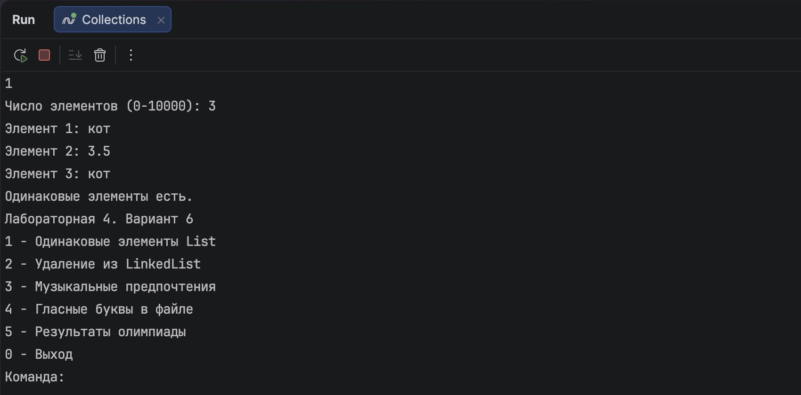

Проверка 2. В меню выбрать 1, ввести количество 2 и элементы 1, 2. Получено сообщение «Одинаковых элементов нет».

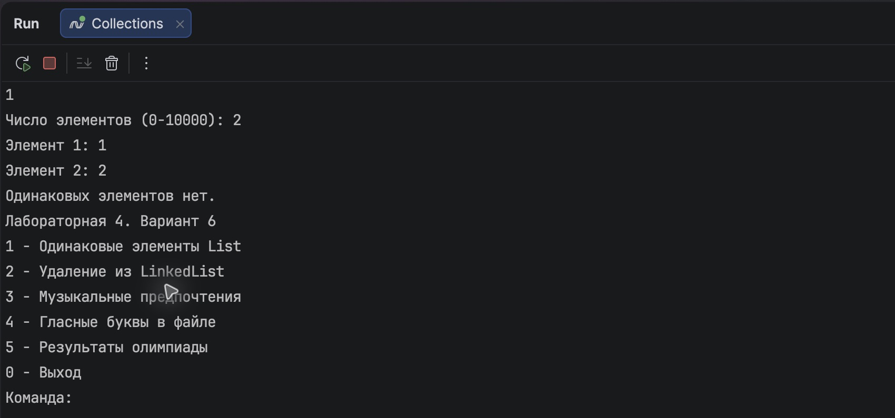

Проверка 3. Вместо команды ввести x, затем команду 9. После сообщений об ошибке выбрать 1. Ввести размер -1, затем исправить на 2; ввести два пустых элемента нажатием Enter. Программа повторяет неверный ввод команды и размера и находит повтор пустых строк.

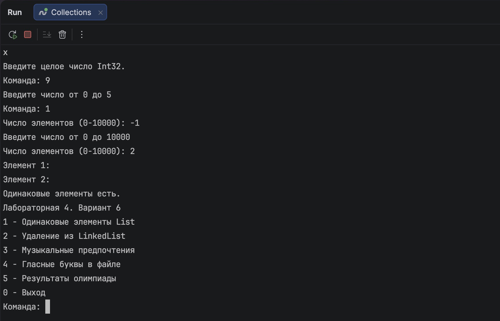

# Задание 2

## Задача 6

### Текст задачи

Удалить из списка L первое вхождение заданного элемента, если такой есть.

### Алгоритм решения

1. Ввести элементы отдельными строками и создать `LinkedList<string>`. Допускаются числа, слова, символы и пустые строки; сравнение точное, с учётом регистра и пробелов.
2. Ввести значение удаляемого элемента.
3. В обобщённом методе `RemoveFirst<T>()` вызвать `LinkedList<T>.Remove(value)`. Этот метод находит и удаляет только первый подходящий узел.
4. По возвращённому `bool` вывести сообщение об удалении или отсутствии элемента.
5. Вывести изменённый список.

Время O(n), дополнительная память O(1).

### Поля класса

Статический класс `CollectionTasks` не содержит полей. Исходные данные передаются в методы; коллекции, потоки и счётчики являются локальными переменными.

### Конструкторы, свойства и методы

- `RemoveFirst<T>(LinkedList<T> values, T value)` удаляет первое вхождение и возвращает признак успеха; `null` отклоняется.
- Конструктор `LinkedList<string>(IEnumerable<string> collection)` создаёт двусвязный список из введённых строк. Метод решения поддерживает любой тип `T` и использует стандартное сравнение элементов этого типа.
- `Program.ShowRemoval()` организует ввод и вывод.

### Тестирование

Проверка 1. Выбрать 2. Ввести список кот, 3.5, кот и удалить значение кот. Получен список 3.5, кот: удалено только первое вхождение.

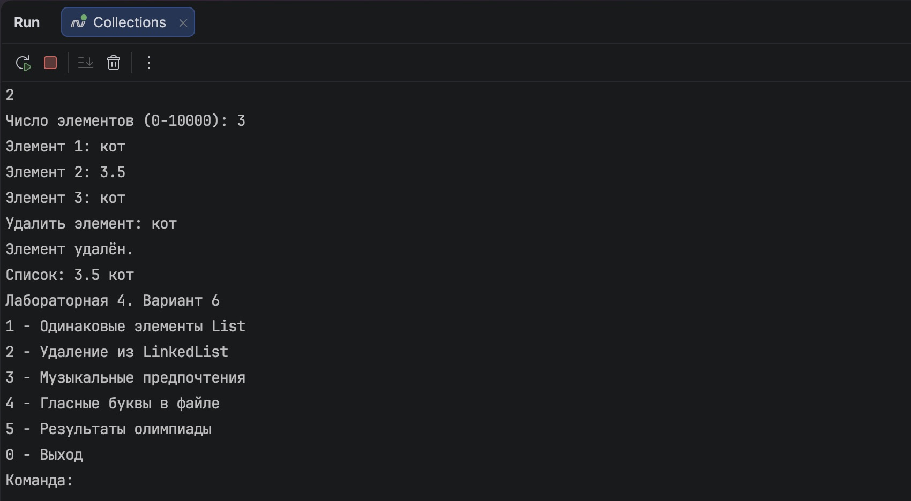

Проверка 2. Выбрать 2. Ввести список 2, 1, 2 и удалить отсутствующее значение 3. Получено сообщение «Элемент не найден», список 2, 1, 2 сохраняется.

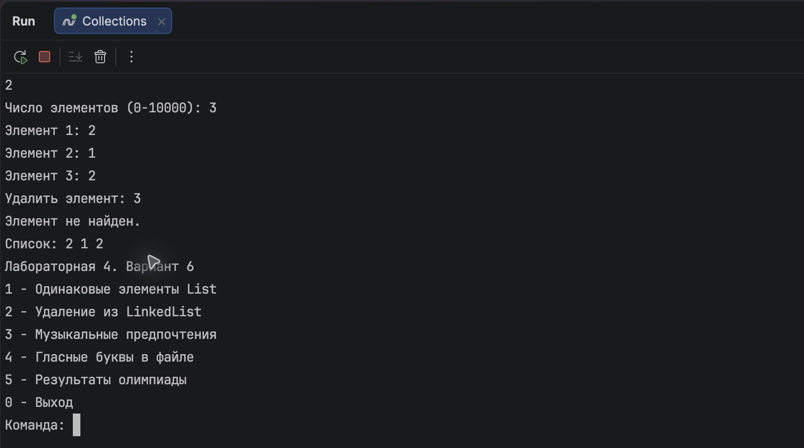

Проверка 3. Выбрать 2. Задать количество элементов 0 и удаляемое значение 2. Получено сообщение «Элемент не найден», список остаётся пустым.

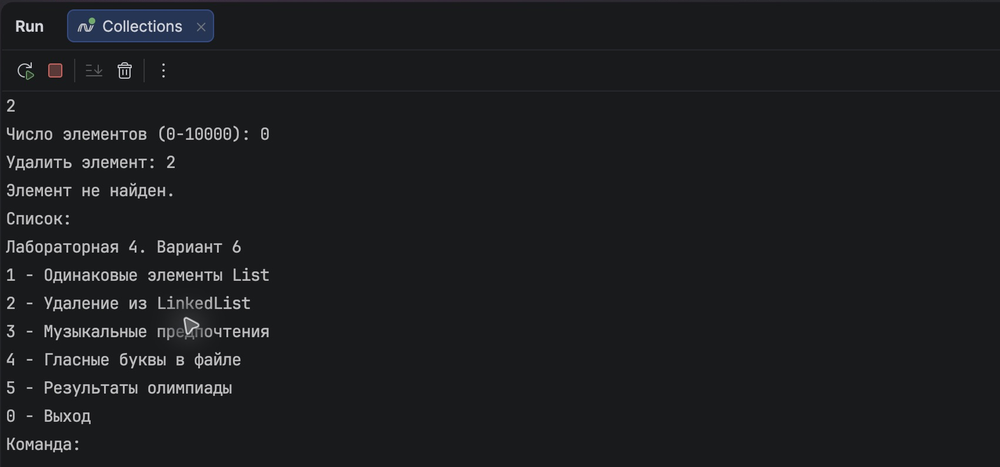

# Задание 3

## Задача 6

### Текст задачи

Есть перечень музыкальных произведений. Определить, какие произведения нравятся всем n меломанам, какие — некоторым из меломанов, а какие — никому.

### Алгоритм решения

1. Ввести общий перечень произведений в `HashSet<string>`. Повторные названия отклонять, регистр не учитывать.
2. Ввести положительное количество меломанов и множество предпочтений каждого. Разрешать только неповторяющиеся названия из перечня.
3. Для категории «всем» создать копию перечня и последовательно выполнить `IntersectWith()` с каждым множеством предпочтений.
4. Для категории «хотя бы одному» создать пустое множество и выполнить `UnionWith()` со всеми предпочтениями.
5. Для категории «никому» вычесть объединение из общего перечня через `ExceptWith()`.
6. Из объединения вычесть пересечение. Получатся произведения, нравящиеся некоторым, но не всем меломанам.
7. Вывести три непересекающиеся категории.

Пустой перечень разрешён, меломанов должен быть хотя бы один. Если m — число произведений, n — число меломанов, k — общее число предпочтений, время обработки в среднем O(nm + k), дополнительная память для результатов O(m); входные множества занимают O(m + n + k).

### Поля класса

Статический класс `CollectionTasks` не содержит полей. Исходные данные передаются в методы; коллекции, потоки и счётчики являются локальными переменными.

### Конструкторы, свойства и методы

- `ClassifyMusic()` принимает перечень и список множеств предпочтений. Через три `out`-параметра возвращает категории `all`, `some`, `none`.
- Метод проверяет ссылки на `null`, наличие хотя бы одного меломана и принадлежность предпочтений перечню.
- `Program.ShowMusic()` вводит исходные данные; `PrintMusic()` выводит категорию или сообщение о её пустоте.

### Тестирование

Проверка 1. Выбрать 3. Ввести перечень A, B, C; для первого меломана выбрать A и B, для второго — A. Всем нравится A, некоторым — B, никому — C.

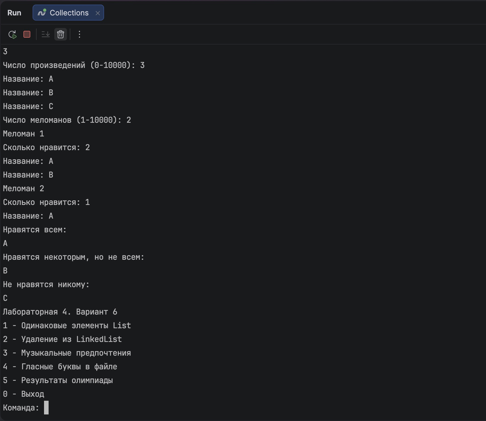

Проверка 2. Выбрать 3. Ввести перечень A, B, C и одного меломана с нулём предпочтений. Категории «всем» и «некоторым» пусты; никому не нравятся A, B, C.

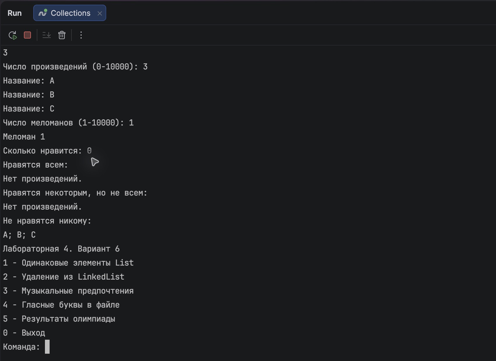

Проверка 3. Выбрать 3 и количество произведений 2. После названия A повторно ввести A, затем исправить на B. Для одного меломана выбрать одно произведение: ввести неизвестное X, затем A. Повторное и неизвестное названия отклоняются; после исправления выводится результат.

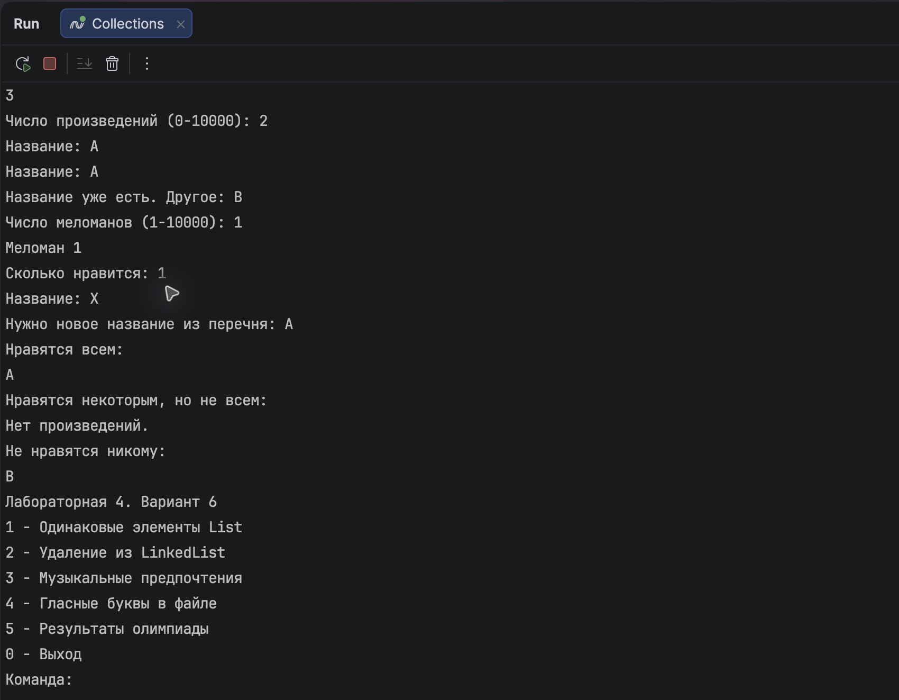

# Задание 4

## Задача 6

### Текст задачи

Файл содержит текст на русском языке. Напечатать в алфавитном порядке все гласные буквы, которые не входят более чем в одно слово.

### Алгоритм решения

1. Ввести число строк и текст с клавиатуры. Отдельным методом `FillTextFile()` записать исходный файл UTF-8.
2. Открыть файл через `StreamReader` и читать по одному символу.
3. Словом считать непрерывную последовательность русских букв `а-я` и `ё`; остальные символы считать разделителями. Приводить буквы к нижнему регистру.
4. Буквы текущего слова накапливать в `HashSet<char>`, чтобы повтор буквы внутри слова не влиял на результат.
5. После каждого слова увеличить счётчики тех гласных, которые в нём присутствуют. Счётчик ограничить числом 2: дальше точное значение не влияет на ответ.
6. Обработать последнее слово, даже если после него нет разделителя.
7. Пройти строку `аеёиоуыэюя` и вывести буквы со счётчиками 0 или 1. Положение `ё` соответствует русскому алфавиту.

По уточнённому условию требуются гласные, **встречающиеся не более чем в одном слове**. Отсутствующие в тексте гласные тоже подходят: число слов с ними равно нулю. Поэтому для пустого файла выводятся все десять гласных.

Время O(T), память O(1): множество содержит не более 33 букв, счётчиков всего 10.

### Поля класса

Статический класс `CollectionTasks` не содержит полей. Исходные данные передаются в методы; коллекции, потоки и счётчики являются локальными переменными.

### Конструкторы, свойства и методы

- `FillTextFile(string path, int count)` записывает строки, введённые с клавиатуры.
- `FindVowels(string path)` возвращает строку гласных в алфавитном порядке.
- `IsRussianLetter()` распознаёт русские буквы, включая `ё`.
- `CountOccurrences()` учитывает гласные, присутствующие в очередном слове.
- `Program.ShowVowels()` организует работу с файлом.

### Тестирование

Проверка 1. Выбрать 4 и одну строку. Ввести текст «мама кот». Получен результат аеёиоуыэюя: а и о встречаются в одном слове каждая, остальные гласные — в нуле слов.

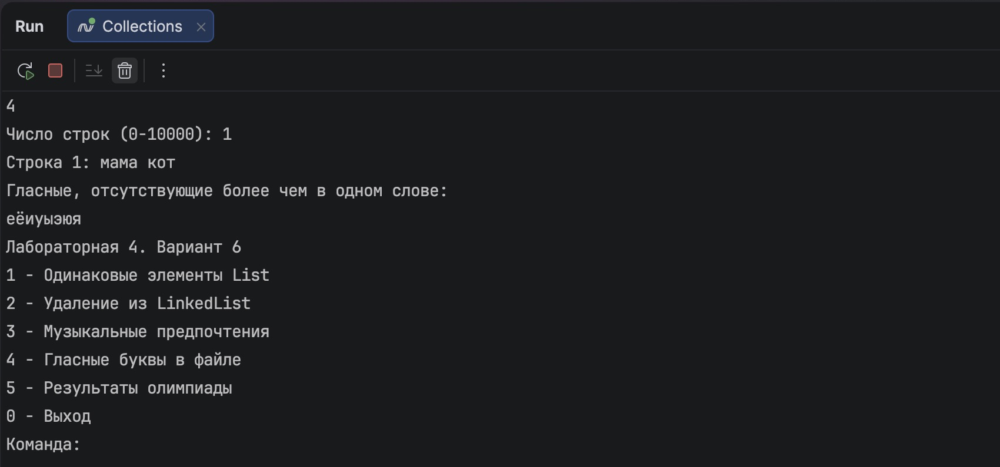

Проверка 2. Выбрать 4 и одну строку. Ввести текст «мама рама кот». Получен результат еёиоуыэюя: а встречается в двух словах и исключается, о — в одном слове, остальные гласные — в нуле слов.

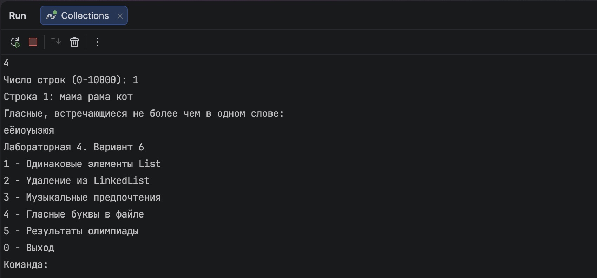

Проверка 3. Выбрать 4 и число строк 0. Создан пустой текстовый файл; получен результат аеёиоуыэюя, поскольку каждая гласная встречается в нуле слов.

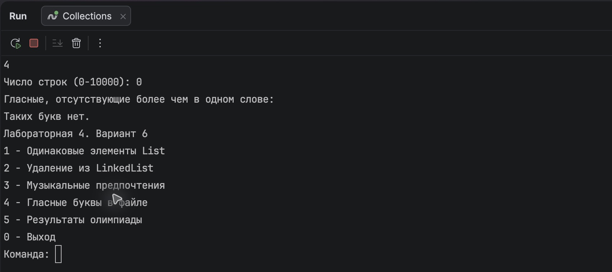

Файл задания: `data/text.txt`.

# Задание 5

## Задача 6

### Текст задачи

На вход программе сначала подаётся число участников олимпиады N. Затем следуют N записей вида `<Фамилия> <Имя> <класс> <баллы>`. Фамилия содержит не более 20 символов, имя — не более 15, класс — от 7 до 11, баллы — целое число. Поля разделены одним пробелом.

Победителем становится участник с наибольшим баллом, если он набрал более 200 баллов. Если максимум набрали несколько участников, они признаются победителями только при доле не более 20% от общего числа участников. При максимуме не более 200 или превышении доли победителей нет.

Определить фамилию и имя лучшего участника, не ставшего победителем. Если таких участников несколько, вывести только их количество. Если победителей нет, искомыми являются лучшие участники. По условию искомые участники имеются. Исходные данные должны храниться в текстовом файле, заполняемом отдельным методом.

### Алгоритм решения

1. В `FillOlympiadFile()` ввести N, затем проверить и записать каждую строку в файл. Баллы принимаются как неотрицательные `Int32`.
2. В `FindBestNonWinner()` открыть файл и проверить N.
3. Создать словарь `Dictionary<int, (int Count, string Name)>`. Ключ — балл, значение — число участников с этим баллом и имя одного из них.
4. Читать записи по одной. В `UpdateLeaders()` увеличить счётчик существующего балла или добавить новый балл со счётчиком 1.
5. Если в словаре стало три ключа, удалить минимальный. Между записями остаются только два наибольших различных балла. Отброшенная группа не может стать одной из двух лучших после добавления новых участников.
6. Проверить отсутствие лишних строк. Найти наибольший и второй различный баллы среди не более чем двух ключей.
7. Если максимум больше 200 и лидер единственный, он победил. Если лидеров несколько, дополнительно проверить `5L * count <= N`. Это точно проверяет 20% без округления и переполнения `int`.
8. При наличии победителей выбрать группу со вторым баллом, иначе — группу с максимальным баллом.
9. Если в выбранной группе один участник, вывести его фамилию и имя; иначе — количество участников.

**Оптимальность:** один проход по N записям, время O(N), дополнительная память O(1). Словарь временно содержит не более трёх записей, имена имеют ограниченную длину. Полный список участников и сортировка не используются. Прочитать все записи необходимо, поскольку последняя может изменить результат; нижняя граница времени — O(N).

### Поля класса

Статический класс `CollectionTasks` не содержит полей. Исходные данные передаются в методы; коллекции, потоки и счётчики являются локальными переменными.

### Конструкторы, свойства и методы

- `FillOlympiadFile(string path)` отдельно создаёт исходный файл с клавиатуры.
- `IsParticipant()` проверяет формат строки, длины фамилии и имени, класс 7–11, неотрицательный балл `Int32` и один пробел между полями.
- `IsName()` проверяет длину и отсутствие пробельных символов внутри фамилии и имени. Дополнительных ограничений на алфавит нет: условие задаёт символьные строки.
- `UpdateLeaders()` поддерживает две группы с наибольшими различными баллами.
- `FindBestNonWinner(string path)` возвращает имя или количество искомых участников. Проверяет число записей, отсутствие лишних строк и существование искомой группы.
- `Program.ShowOlympiad()` вызывает заполнение файла и выводит результат.

### Тестирование

Проверка 1. Выбрать 5. Ввести двух участников: «Иванов Иван 11 225» и «Петров Пётр 7 200». Получен результат «Петров Пётр». Единственный лидер с 225 баллами становится победителем.

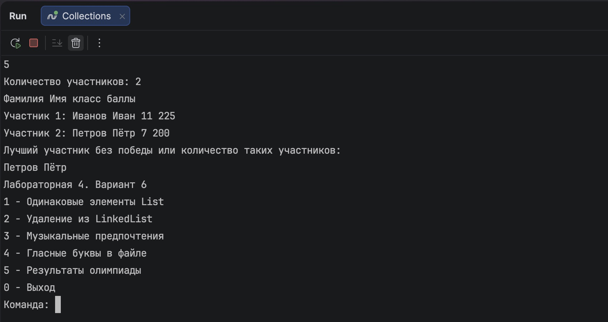

Проверка 2. Выбрать 5. Ввести 10 участников с баллами 300, 300, 250, 230, 200, 180, 170, 160, 150, 140. Два лидера занимают ровно 20% и побеждают. Лучший участник без победы — Сидоров Егор с 250 баллами.

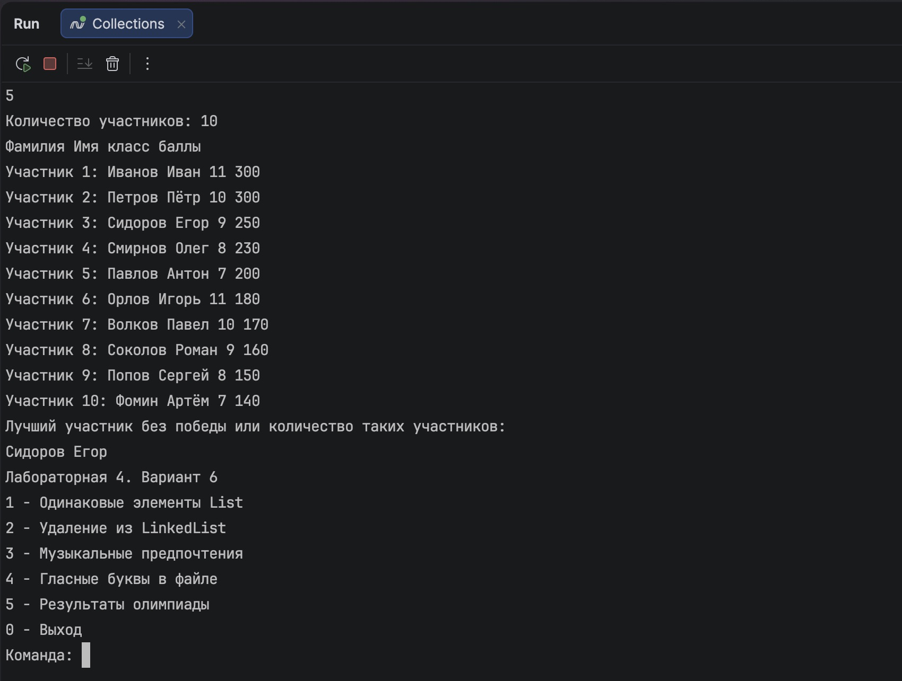

Проверка 3. Выбрать 5. Ввести трёх участников с баллами 200, 200, 199. Максимум ровно 200 не даёт победы. Получен ответ 2 — количество лучших участников.

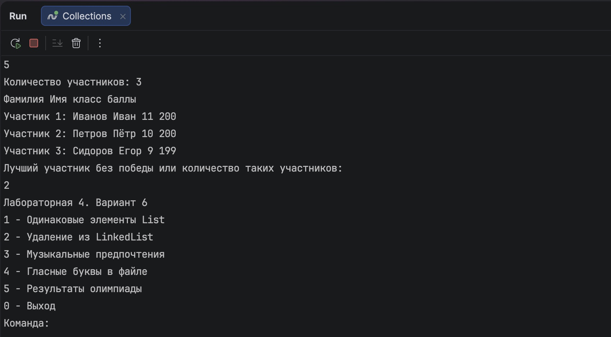

Проверка 4. Выбрать 5 и количество участников 2. Для первого участника ввести класс 6, затем повторить с классом 11 и баллом -1. Обе записи отклоняются. После исправления на «Иванов Иван 11 225» и ввода «Петров Пётр 7 200» получен результат «Петров Пётр».

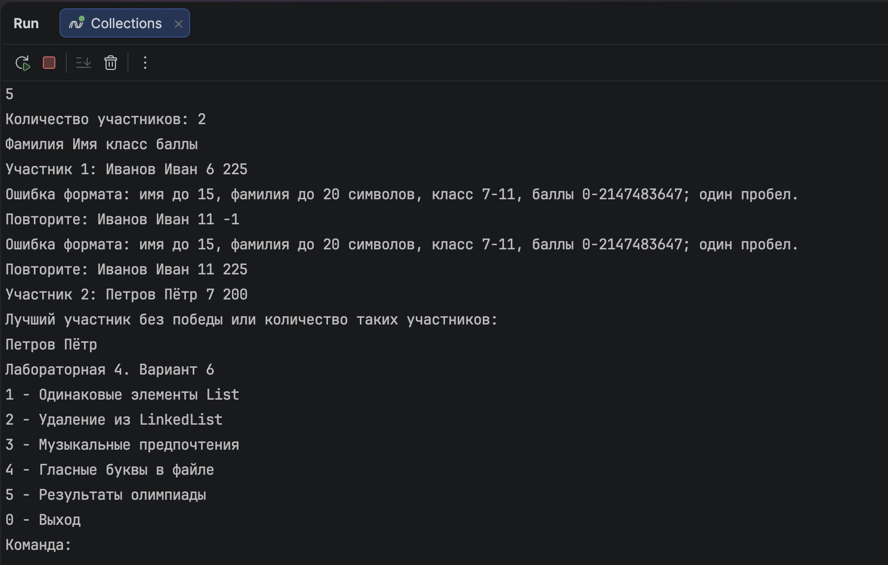

Файл задания: `data/olympiad.txt`.

# Задание 6

## Задача 6

### Текст задачи

Определить класс `QuadraticEquation` с коэффициентами a, b, c типа `double`. Реализовать поля, свойства, конструкторы, `ToString()` и вычисление корней квадратного уравнения. Результат — массив `double[]`, содержащий от 0 до 2 элементов в зависимости от числа действительных корней.

### Алгоритм решения

1. Создать три закрытых поля и обычные свойства `A`, `B`, `C` с проверкой коэффициентов. Не допускать `NaN`, бесконечности и a = 0: класс представляет квадратное уравнение.
2. Реализовать конструктор без параметров для уравнения x² = 0, конструктор с тремя параметрами и конструктор копирования.
3. В `FindRoots()` сначала масштабировать коэффициенты общей степенью двойки через `Math.ILogB` и `Math.ScaleB`, затем вычислить дискриминант масштабированного уравнения. Корни от такого масштабирования не меняются; предотвращается ложное обнуление дискриминанта для малых коэффициентов.
4. Если D < 0, вернуть пустой массив. Если D = 0, вернуть массив из одного корня -b / (2a).
5. Если D > 0, использовать устойчивую формулу `q = -0.5 * (b + CopySign(sqrt(D), b))`. Корни равны `q / a` и `c / q`. Она уменьшает потерю точности малого корня при вычитании близких чисел.
6. Проверить конечность результатов и вернуть корни по возрастанию. Нечисловой или бесконечный корень вызывает `OverflowException` с понятным сообщением. Если разброс коэффициентов настолько велик, что при масштабировании теряется ненулевой коэффициент, вычисление также отклоняется.
7. В `ToString()` вывести значения трёх коэффициентов.

Все операции имеют время O(1) и память O(1). Вычисления выполняются с точностью `double`; комплексные корни не вычисляются.

### Поля класса

| Поле | Тип | Назначение |
| --- | --- | --- |
| `QuadraticEquation._a` | `double` | Коэффициент при x²; не равен нулю. |
| `QuadraticEquation._b` | `double` | Коэффициент при x. |
| `QuadraticEquation._c` | `double` | Свободный член. |

Это единственные поля класса `QuadraticEquation`. Доступ к ним предоставляют обычные свойства `A`, `B`, `C` с явно записанными блоками `get` и `set`.

### Конструкторы, свойства и методы

- `QuadraticEquation()` задаёт коэффициенты 1, 0, 0.
- `QuadraticEquation(double a, double b, double c)` проверяет и задаёт коэффициенты через свойства.
- `QuadraticEquation(QuadraticEquation other)` копирует значения полей; `null` отклоняется.
- Свойства `A`, `B`, `C` предоставляют чтение и запись с проверкой.
- `FindRoots()` возвращает массив действительных корней.
- `GetScaledDiscriminant()` масштабирует коэффициенты степенью двойки. `GetDiscriminant()` восстанавливает исходный дискриминант; `CheckFinite()` и `CheckResult()` выполняют проверки.
- `ToString()` выводит все коэффициенты.
- `Program.ReadEquation()`, `SetCoefficient()` и `PrintRoots()` организуют ввод и проверку методов через меню.

### Тестирование

Проверка 1. В программе Equations задать коэффициенты 1, -3, 2 и выбрать команду 3. Получены два корня: 1 и 2.

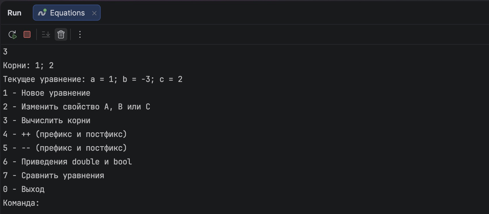

Проверка 2. Задать коэффициенты 1, 2, 1 и выбрать команду 3. Получен единственный корень -1.

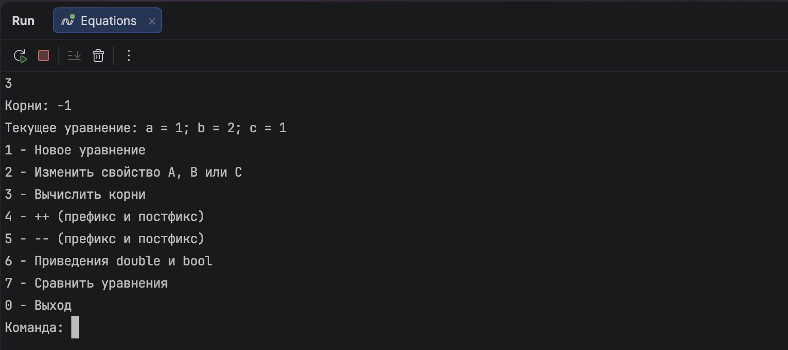

Проверка 3. Командой 1 задать коэффициенты 1, 0, 1, затем выбрать 3. Получено сообщение «Действительных корней нет».

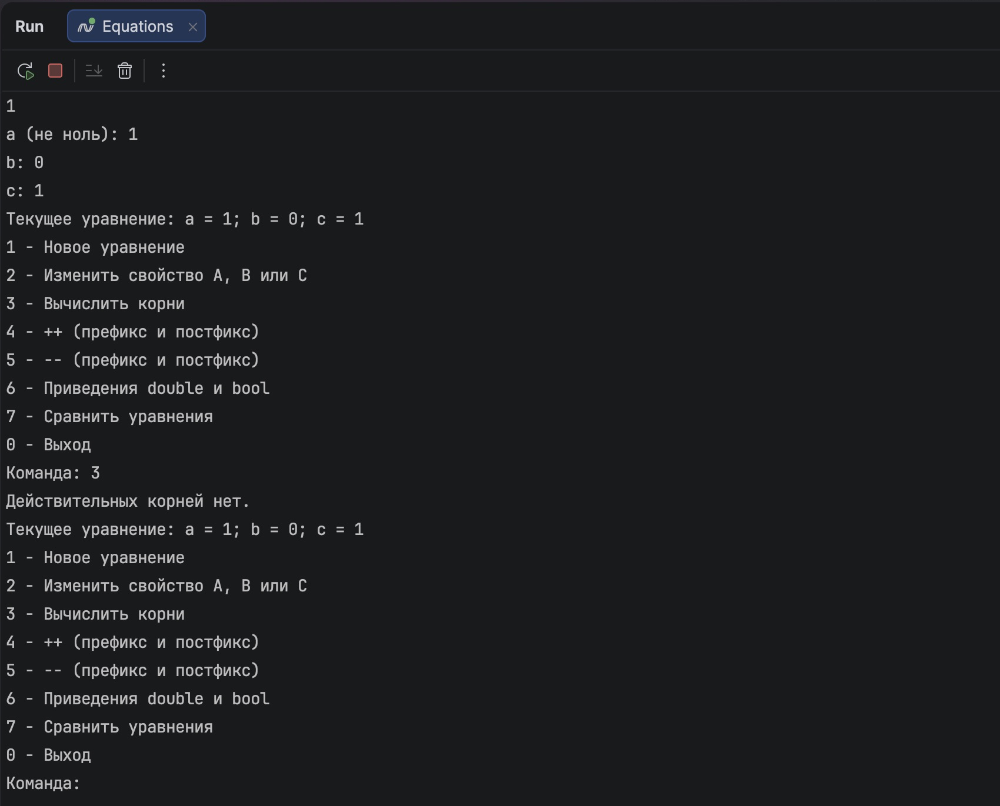

Проверка 4. Выбрать команду 1. Для коэффициента a последовательно ввести 0, NaN, Infinity. Нулевое и неконечные значения отклоняются. После ввода a = 1, b = -3, c = 2 программа возвращается в меню с корректным уравнением.

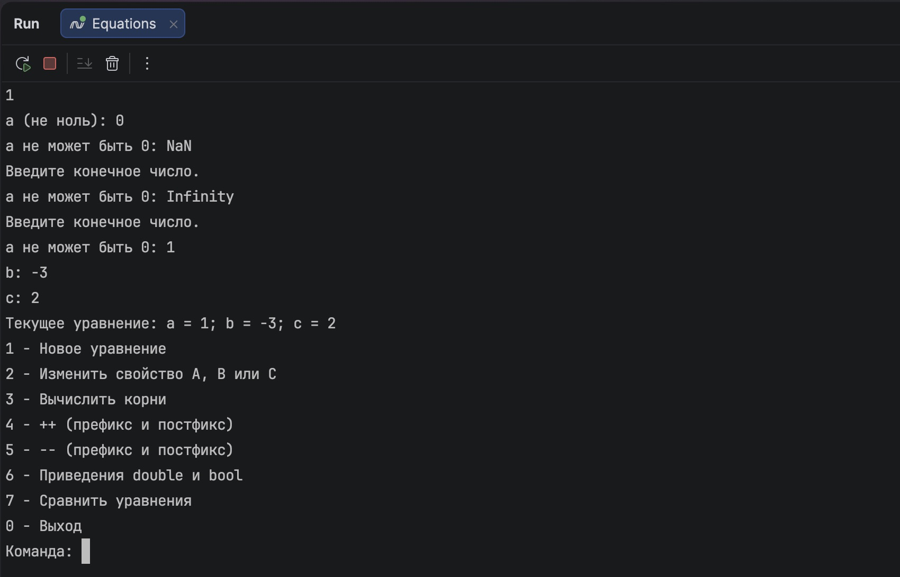

# Задание 7

## Задача 6

### Текст задачи

Добавить к классу `QuadraticEquation` перегруженные операции:

- `++` увеличивает все коэффициенты на 1;
- `--` уменьшает все коэффициенты на 1;
- неявное приведение к `double` возвращает дискриминант;
- явное приведение к `bool` возвращает `true`, если действительные корни существуют, иначе `false`;
- `==` и `!=` сравнивают соответствующие коэффициенты уравнений.

### Алгоритм решения

1. Операторы `++` и `--` проверяют ссылку на `null` и создают новый объект с изменёнными коэффициентами.
2. Благодаря созданию нового объекта постфиксная форма возвращает прежнее значение, префиксная — новое. Другие ссылки на прежний объект сохраняют его значение.
3. Если после изменения a становится равным нулю, конструктор отклоняет результат. Текущий объект при ошибке сохраняется.
4. Для неявного приведения к `double` восстановить исходный дискриминант. Для явного к `bool` сравнить с нулём масштабированный дискриминант: знак сохраняется даже при слишком малом исходном дискриминанте. Если исходный дискриминант не помещается в `double`, приведение к `double` выдаёт `OverflowException`, но вычислимые корни и `bool` остаются доступны.
5. Для `==` сначала проверить совпадение ссылок, затем случаи `null`, затем точное равенство всех коэффициентов.
6. Для `!=` вернуть отрицание результата `==`.
7. Переопределить `Equals()` и `GetHashCode()` согласованно с равенством коэффициентов.
8. Проверить обе формы `++`/`--`, оба приведения и оба сравнения через консольное меню.

Время и память каждой операции O(1).

### Поля класса

| Поле | Тип | Назначение |
| --- | --- | --- |
| `QuadraticEquation._a` | `double` | Коэффициент при x²; не равен нулю. |
| `QuadraticEquation._b` | `double` | Коэффициент при x. |
| `QuadraticEquation._c` | `double` | Свободный член. |

Это единственные поля класса `QuadraticEquation`. Доступ к ним предоставляют обычные свойства `A`, `B`, `C` с явно записанными блоками `get` и `set`.

### Конструкторы, свойства и методы

- `operator ++` и `operator --` возвращают новый объект `QuadraticEquation`.
- `implicit operator double` возвращает дискриминант.
- `explicit operator bool` проверяет наличие действительных корней.
- `operator ==` и `operator !=` сравнивают коэффициенты; поддерживают `null`.
- `Equals(object other)` сравнивает объект с другим уравнением.
- `GetHashCode()` объединяет хеши трёх коэффициентов через `HashCode.Combine()`.
- `Program.ShowChange()` демонстрирует префиксную и постфиксную формы; `Compare()` проверяет операции сравнения.

### Тестирование

Проверка 1. Для коэффициентов 1, -3, 2 выбрать команду 4 и постфиксную форму 2. Результат выражения содержит прежние коэффициенты 1, -3, 2; после операции текущее уравнение имеет коэффициенты 2, -2, 3.

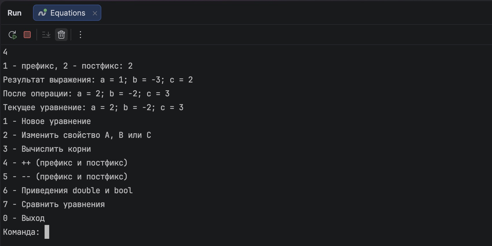

Проверка 2. Для коэффициентов 1, -3, 2 выбрать команду 6. Неявное приведение к double даёт дискриминант 1, явное приведение к bool — True.

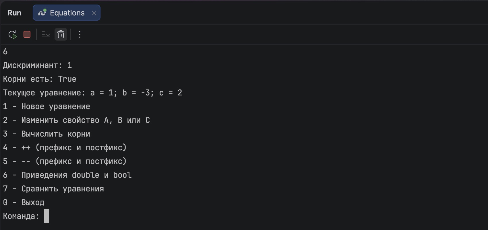

Проверка 3. Для текущего уравнения 1, -3, 2 выбрать команду 7 и ввести второе уравнение с теми же коэффициентами. Получено: == True, != False, Equals True; хеши совпадают.

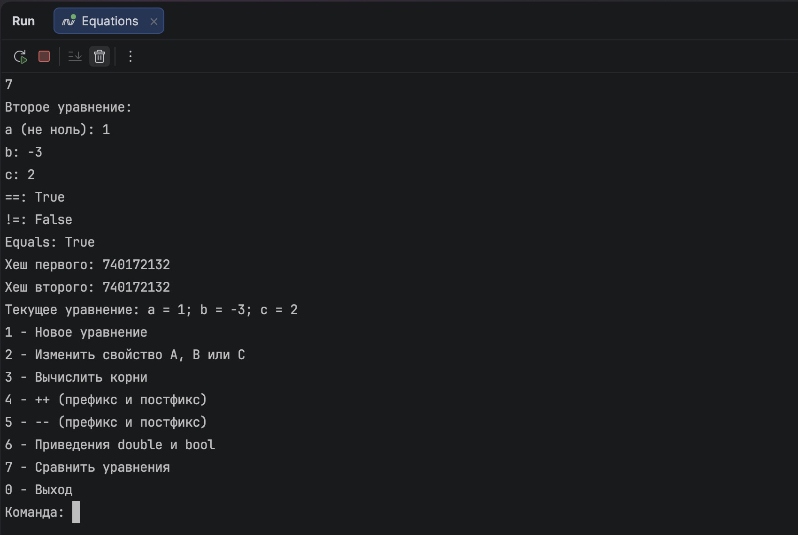

Проверка 4. Для коэффициентов 1, -3, 2 выбрать команду 5 и префиксную форму 1. Операция -- отклоняется, поскольку a становится нулём. Прежние коэффициенты 1, -3, 2 сохраняются.

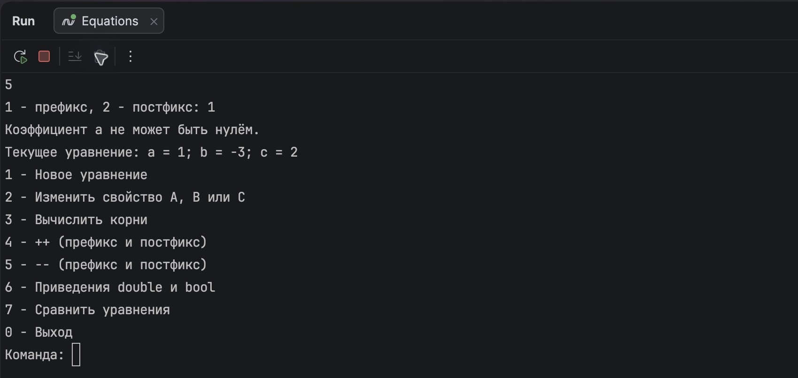

# Запуск

Требуется [.NET SDK 10](https://dotnet.microsoft.com/download/dotnet/10.0).

```bash
git clone https://github.com/Quiniful/lab4_csharp.git
cd lab4_csharp
dotnet run --project Collections/Collections.csproj
dotnet run --project Equations/Equations.csproj
```

Либо открыть `Lab4.slnx` в Rider или Visual Studio с поддержкой .NET 10. Проект `Collections` содержит задания 1–5, проект `Equations` — задания 6–7. Команда `0` завершает работу. Файлы данных создаются в папке `data` текущего каталога запуска.

[Отчёт по лабораторной работе](Отчет_Лаб4_Козарчук_Вариант6.docx).
